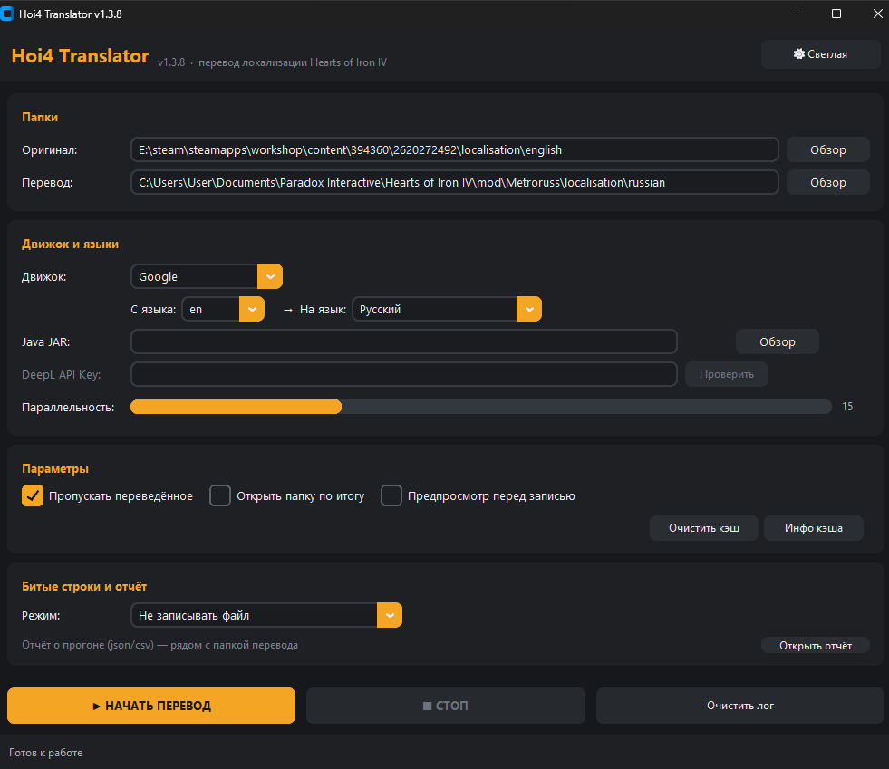

# 🌍 HoI4 Localization Tool

[](https://github.com/xsitraxs/Hoi4_translator/releases/latest)
[](https://github.com/xsitraxs/Hoi4_translator/releases)
[](https://github.com/xsitraxs/Hoi4_translator/actions/workflows/build.yml)
[](LICENSE)

**Batch-translate Hearts of Iron IV mod localization, without breaking Paradox formatting.**

Point the tool at a mod's `localisation` folder, pick a target language and an engine: it translates the values, keeps the keys untouched, and refuses to write a file it cannot verify. `$VALUE$`, `§R…§!`, `£money`, `[GetTag]`, `\n` and `"` escapes survive the round trip.

**Читать по-русски:** [README.md](README.md) — the Russian README is the full one (every option, cache behaviour, reports, troubleshooting).

---

## ⬇️ Download

| What | Who |
| --- | --- |
| **[Hoi4_Translator.exe](https://github.com/xsitraxs/Hoi4_translator/releases/latest)** | Windows, no Python required — just run it |
| `hoi4_translator.jar` | JavaSim engine, put it next to the EXE (needs Java 11+) |
| From source | Python 3.9+, `pip install -r requirements.txt`, then `python hoi4_translator.py` |



### What the output looks like

Keys are never touched and markers survive — only the text changes:

```yml
# before (en)
l_english:
 GER_rearm_the_rhine:0 "Rearm $STATE$ with £army_experience|1 and [GetPlayerTag] backing."
 USA_war_goal_ussr:0 "§YDeclare war§! on $TARGET$ and gain §G+10%§! war support."

# after (ru)
l_russian:
 GER_rearm_the_rhine:0 "Перевооружите $STATE$ с помощью £army_experience|1 и поддержки [GetPlayerTag]."
 USA_war_goal_ussr:0 "§YОбъявите войну§! государству $TARGET$ и получите §G+10%§! поддержки войны."
```

If an engine mangles a single marker, the line is reported, and by default the whole file is not written at all.

## 🔒 Is the EXE safe to run?

Antivirus and SmartScreen warnings on PyInstaller builds are normal, but you should still verify:

* **Where it came from.** The EXE is built by GitHub Actions from this repository; each release notes which CI run produced it.
* **Checksum.** Releases ship a `SHA256SUMS.txt` with the hashes of the EXE and the JAR — check it locally:
  ```powershell
  certutil -hashfile Hoi4_Translator.exe SHA256
  ```
  or `sha256sum -c SHA256SUMS.txt` on Linux/macOS.
* **SmartScreen.** The binary is not code-signed (that costs money), so Windows will warn you: "More info" → "Run anyway".
* **VirusTotal.** If the release notes link a scan report, check the file there; running from source needs none of this.
* **No trust in binaries at all.** MIT source is right here — run it with Python 3.9+ instead.

## ✨ What it does

* **Engines:** DeepL (official client, API key stored in the OS credential store), Google Translate, MyMemory, and an optional Java engine (JavaSim).
* **Fallback chain:** `DeepL → Google → MyMemory`. Every substitution is logged and counted in the summary, so a paid engine never degrades to a free one silently.
* **Fallback on a broken answer:** a reply that cannot be written to the game (a lost `$STATE$`, a broken one-line format) counts as a failed attempt, not as a translation: that single line moves on to the next engine while the rest of the batch is untouched. Only a value that passed validation is cached, so a later run never reuses known-broken text. If no engine produced a usable value the line is not passed off as translated: the strict mode refuses the file, and "replace the broken line with the original" keeps the English text for that line and reports it.
* **Placeholder protection:** variables, formatters, colour codes, gradients, icons and escape sequences are masked before translating and restored afterwards.
* **Glossary:** a `term → translation` file (TSV/CSV/JSON). Terms are masked out before the request and written back already translated, so an engine cannot translate them differently or reorder them. See [`docs/glossary-example.tsv`](docs/glossary-example.tsv).
* **Vanilla reuse:** point it at the installed game's `localisation` folder and any line the mod copied from the base game takes the official translation — those lines never reach an engine.
* **Headless CLI:** `python hoi4_translator.py --cli --src ... --dst ... --target ru` for CI and servers without a display.
* **Line-level validation:** if a translation loses a marker, the file is not written by default (`Do not write the file`) — alternatively the broken line can be replaced with the English original and reported.
* **Cache:** SQLite. A key is `text + language pair + engine`, so switching engines does not serve stale results. "Skip already translated" also stores a checksum of the source line, so a mod author's edit invalidates the old translation.
* **Preview:** the first 1000 lines of each file can be reviewed and edited before saving.
* **Run report:** `hoi4_translator_report_<date>.json` and `.csv` next to the output folder — files, written/rejected/cancelled counts, fallbacks, broken and recovered lines.
* **Output format:** UTF-8 **with BOM**, `l_<language>:` header, `_l_<language>.yml` suffix, relative folder structure preserved.
* **GUI:** CustomTkinter, dark theme with an amber accent, live log, twin progress bars, cancel that actually cancels requests.

## 🛠 Requirements

1. **Python 3.9+** (CI runs 3.9, 3.11 and 3.13) — only for the source install.
2. **Java JDK 11+** — only for the optional JavaSim engine.
3. `python -m pip install -r requirements.txt`

### Running from source

```bash
git clone https://github.com/xsitraxs/Hoi4_translator.git
cd Hoi4_translator
python -m pip install -r requirements.txt
python hoi4_translator.py        # --help / --version also work
```

## 🖥 Headless mode

```bash
python hoi4_translator.py --cli \
  --src "MOD/localisation/english" \
  --dst "OUT/localisation/russian" \
  --target ru --engine Google \
  --glossary docs/glossary-example.tsv \
  --vanilla "C:/Steam/steamapps/common/Hearts of Iron IV/localisation"
```

`--dry-run` parses the files and reports broken lines, duplicate keys and notes about `§` without translating or writing anything — no game and no internet needed. Lines marked `!` make the translator skip the file; `~` marks notes about the mod's own markup — those files still translate and the check exits with `0`.

Only the translation can break a file. When the English source already has an unclosed colour (closed later by a `$VARIABLE$`) or a bare `§R`, the line is written exactly as it is with a warning, instead of losing a file that may hold thousands of good keys.

Real files shape the parser: a value ends at the last quote on the line, so unescaped quotes inside the text do not break it; `§[expression]` is a dynamic colour and `§§` is a literal section sign. Verified on 110 files and 213 623 keys from Kaiserreich and Millennium Dawn.

`KEY:0` and `KEY:7` are the same localisation key (the number is only a revision marker), so a file that repeats a key with different numbers is rejected instead of being written with overlapping entries.

DeepL needs a key (`--api-key` or `DEEPL_API_KEY`); without one the CLI exits with code `2` rather than silently falling back to a free engine.

Useful flags: `--skip-translated`, `--broken-lines keep-original`, `--concurrency N`, `--no-report`, `--quiet`; `--cli --help` lists everything. Exit codes: `0` all files written, `1` at least one file failed, `2` bad arguments or folders (nothing started).

## 📁 Choosing folders

Use the **same root level** for source and destination. If the source is a mod root, the output must be another mod root. If the source is the `localisation` folder, pick an output `localisation` root. The tool keeps the relative structure and swaps the language folder/suffix for the target language.

## ⚠️ Known limitations

* The Google path uses the unofficial `translate.googleapis.com/translate_a/single` endpoint; its response format can change at any time (429 retries are implemented).
* MyMemory has hard daily limits — it is the last resort in the chain.
* The preview window covers the first 1000 lines; the rest is saved as translated.
* The GUI is currently Russian-only.
* A glossary disables the translation cache: the cache is keyed by source text, and a different glossary would silently answer with a translation made under another term list.

## 👩‍💻 Development

```bash
python -m pip install -r requirements.txt ruff coverage
python -m ruff check hoi4_translator.py hoi4translator/ tests/
python -m unittest discover -s tests -v
```

Tests describe behaviour (format parser, marker validation, cache, cancellation, file writing). `tests/tk_stub.py` replaces tkinter and CustomTkinter with recording stubs, so GUI wiring is covered without a display — visual appearance still needs a human eye.

## 📄 License

MIT — see [LICENSE](LICENSE).
